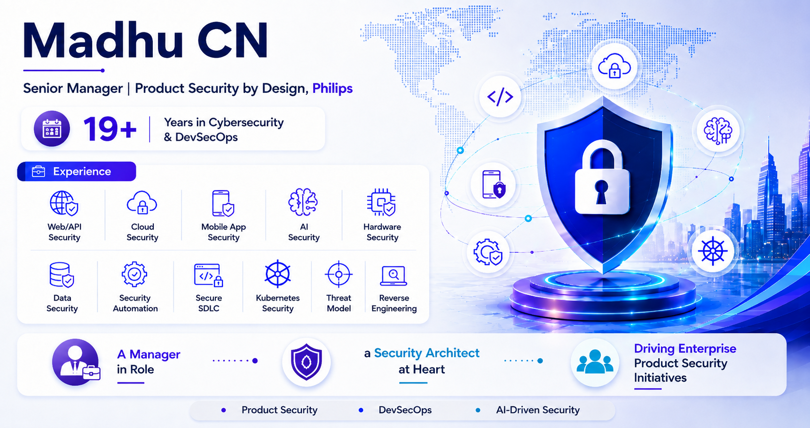

<!-- The OWASP Top 10 for LLM Applications (2025) training was designed and developed by CN Madhu (madhu.cn@philips.com). This program combines industry-relevant content and practical labs to showcase real-world AI security risks, vulnerabilities, and defense strategies in healthcare environments. -->

<!-- _class: lead -->

<!-- _class: image -->

 

---

<!-- _class: lead -->

---

